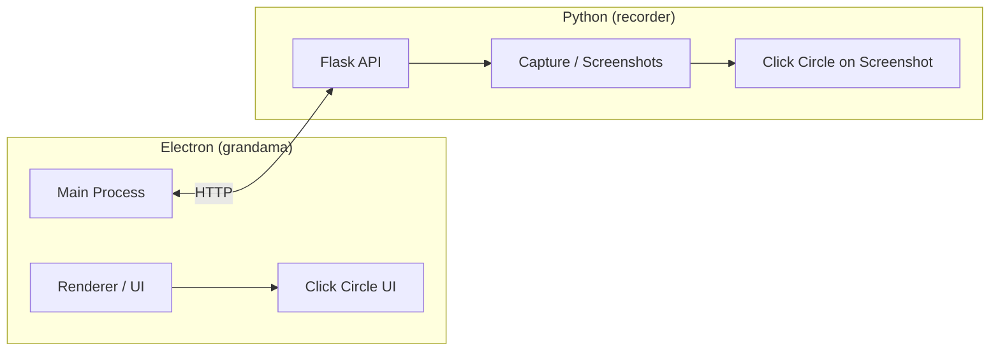

Project Grandma uses Electron for UI and Python for the recording engine. Communications flow through an HTTP API between the Electron frontend and Python backend.

See [Building from Source](/dev/build/) for implementation details.
