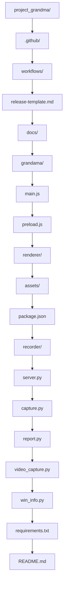
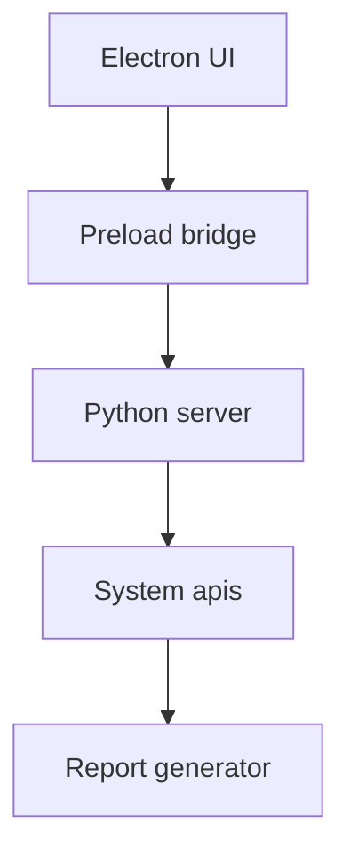

## Prerequisites

1. **Node.js** (v16+): [Download](https://nodejs.org/)
2. **Python 3** (3.8+): [Download](https://www.python.org/)
3. **Git**: [Download](https://git-scm.com/)
4. **Administrator Access** (for Windows builds)

## Setup

### 1. Clone Repository

```bash
git clone https://github.com/ktsoaela/project_grandma.git
cd project_grandma
```

### 2. Install Node Dependencies

```bash
cd grandama
npm install
```

### 3. Install Python Dependencies

```bash
cd ../recorder
pip install -r requirements.txt
```

## Development

### Run in Development Mode

```bash
cd project_grandma/grandama
npm run dev
```

This starts:
- Electron UI (http://localhost)
- Python backend (port 37482)
- File watching for changes

### Run Individual Parts

```bash
# Electron only
npm run start:electron

# Python server only
npm run start:python
```

## Building

### Windows (Must run as Administrator)

```bash
# Right-click PowerShell → Run as Administrator
cd project_grandma/grandama
npm run build:win
```

**Outputs:**
- `dist/Project-Grandma-X.X.X.exe` (installer)
- `dist/Project Grandma.exe` (portable)
- `dist/win-unpacked/` (unpacked files)

### macOS

```bash
cd project_grandma/grandama
npm run build:mac
```

**Outputs:**
- `dist/Project-Grandma-X.X.X.dmg` (installer)
- `dist/Project-Grandma-X.X.X.zip` (app bundle)

### All Platforms

```bash
# Only works on macOS - builds Windows and macOS
npm run build:all
```

## Project Structure



## Architecture

### Communication Flow



### Key Files

| File | Purpose |
|------|---------|
| `main.js` | Electron main process, window management |
| `preload.js` | IPC bridge between UI and Python |
| `server.py` | Flask API endpoints |
| `capture.py` | Mouse/keyboard listeners |
| `report.py` | Exports HTML, PDF, Markdown |

## Debugging

### Enable Debug Mode

Set environment variable:
```bash
# Windows
set DEBUG=project-grandma:*

# macOS/Linux
export DEBUG=project-grandma:*
```

### View Python Logs

```bash
# Check Python output in terminal where you ran npm run dev
```

### Electron DevTools

In development mode:
- Press `F12` to open DevTools
- Check Console for JavaScript errors
- Use Network tab for API calls

## Testing

### Unit Tests (Future)

```bash
npm run test
```

### Manual Testing Checklist

- [ ] App starts correctly
- [ ] Recording works
- [ ] Add comment works
- [ ] All export formats work
- [ ] Stop recording works
- [ ] Files save correctly

## Common Issues

**"Python not found"**
```bash
# Specify path explicitly
python3 -c "import sys; print(sys.version)"
```

**"Port 37482 already in use"**
```bash
# Find process using port
netstat -ano | findstr :37482

# Kill process (get PID from above)
taskkill /PID [PID] /F
```

**"Building fails with code signing errors"**
- Run PowerShell as Administrator
- Ensure `forceCodeSigning: false` in package.json

## Contributing Changes

1. Make changes
2. Test thoroughly
3. Commit with clear message
4. Submit pull request

See [Contributing Guide](/dev/contributing/) for details.
