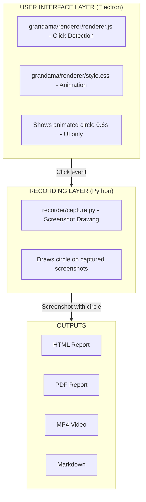
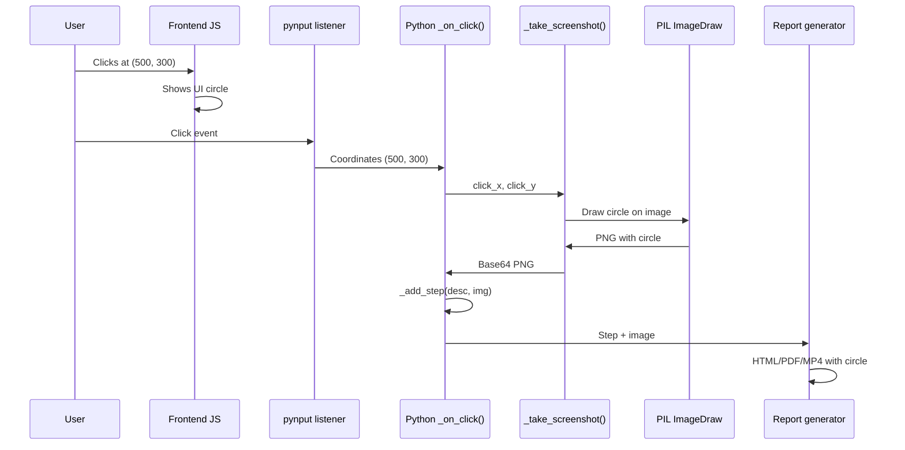

## Table of Contents

1. [Architecture Overview](#architecture-overview)
2. [Frontend Implementation](#frontend-implementation)
3. [Backend Implementation](#backend-implementation)
4. [Integration Points](#integration-points)
5. [Modification Details](#modification-details)
6. [Testing & Debugging](#testing--debugging)

---

## Architecture Overview

The click circle feature is implemented in two separate layers:



---

## Frontend Implementation

### Location
```
grandama/
├── renderer/
│   ├── style.css          ← Circle styling & animation
│   ├── renderer.js        ← Click event handler
│   └── index.html
```

### 1. CSS Circle Definition

**File**: `grandama/renderer/style.css`

```css
/* Default circle element styling */
.click-circle {
  position: fixed;              /* stays on top of content */
  width: 40px;                  /* circle diameter */
  height: 40px;                 /* must equal width */
  border: 3px solid #4CAF50;    /* green outline, 3px thick */
  border-radius: 50%;           /* makes it circular */
  pointer-events: none;         /* doesn't block clicks */
  z-index: 10000;               /* high stacking order */
  animation: clickRipple 0.6s ease-out forwards;
}

/* Ripple animation - expands and fades */
@keyframes clickRipple {
  0% {
    transform: translate(-50%, -50%) scale(0);      /* starts at center, size 0 */
    opacity: 1;                                      /* fully opaque */
  }
  100% {
    transform: translate(-50%, -50%) scale(1.5);    /* 150% of original size */
    opacity: 0;                                      /* fully transparent */
  }
}
```

**How the animation works:**
1. Click happens at position (x, y)
2. Circle created at that position with `scale(0)` - invisible dot
3. Over 0.6 seconds:
   - Circle expands to 1.5x size
   - Simultaneously fades to transparent
4. At 0.6s, circle is completely faded out and removed from DOM

### 2. JavaScript Click Handler

**File**: `grandama/renderer/renderer.js`

```javascript
// Click circle effect during recording
document.addEventListener('click', (e) => {
  // Only show circle when recording
  if (recordingState.classList.contains('hidden')) return;
  
  // Create circle element
  const circle = document.createElement('div');
  circle.className = 'click-circle';
  
  // Position at exact click location
  circle.style.left = e.clientX + 'px';    /* horizontal position */
  circle.style.top = e.clientY + 'px';     /* vertical position */
  
  // Add to DOM - becomes visible immediately with animation
  document.body.appendChild(circle);
  
  // Remove from DOM after animation (0.6s)
  setTimeout(() => circle.remove(), 600);
});
```

**Key points:**
- `document.addEventListener('click', ...)` - listens to ALL clicks during recording
- `e.clientX` and `e.clientY` - get exact click position in viewport
- The circle element is added/removed dynamically - no permanent DOM nodes

### Frontend Customization Reference

| Property | Default | Effect | How to Change |
|----------|---------|--------|---|
| `width` | 40px | Starting diameter | Edit `.click-circle` class |
| `height` | 40px | Must match width | Edit `.click-circle` class |
| `border` | 3px solid #4CAF50 | Line width & color | Edit `.click-circle` class |
| Animation time | 0.6s | Duration | Edit `clickRipple` duration |
| Scale max | 1.5 | Max expansion | Edit `scale(1.5)` in keyframe |

---

## Backend Implementation

### Location
```
recorder/
├── capture.py      ← Screenshot drawing & circle rendering
├── server.py       ← Flask endpoints
└── requirements.txt ← Dependencies (Pillow required)
```

### 1. Screenshot Capture with Circle

**File**: `recorder/capture.py`

```python
def _take_screenshot(self, click_x=None, click_y=None):
    """
    Capture screenshot and optionally draw a circle at click location.
    
    Args:
        click_x: X coordinate of click (None = no circle)
        click_y: Y coordinate of click (None = no circle)
    
    Returns:
        Base64-encoded PNG image
    """
    if not mss:
        return None
    
    try:
        with mss.mss() as sct:
            # Get primary monitor
            mon = sct.monitors[0]
            
            # Capture raw screenshot data
            shot = sct.grab(mon)
            
            # Draw circle if click coordinates provided
            if click_x is not None and click_y is not None and PIL_AVAILABLE:
                # Convert MSS RawImage to PIL Image
                img = Image.frombytes('RGB', shot.size, shot.rgb)
                
                # Create drawing context (like a pen/brush)
                draw = ImageDraw.Draw(img)
                
                # Calculate circle bounds
                # Circle has a center point and radius
                circle_radius = 20
                x1 = click_x - circle_radius  # left edge
                y1 = click_y - circle_radius  # top edge
                x2 = click_x + circle_radius  # right edge
                y2 = click_y + circle_radius  # bottom edge
                
                # Draw green circle outline
                # Parameters: [x1, y1, x2, y2], outline_color, width_in_pixels
                draw.ellipse([x1, y1, x2, y2], outline='#4CAF50', width=3)
                
                # Convert PIL Image back to PNG bytes
                from io import BytesIO
                buf = BytesIO()
                img.save(buf, format='PNG')
                img_bytes = buf.getvalue()
            else:
                # No click coordinates = use default screenshot conversion
                img_bytes = mss.tools.to_png(shot.rgb, shot.size)
            
            # Encode as base64 for JSON transmission
            return base64.b64encode(img_bytes).decode('ascii')
    
    except Exception:
        return None
```

### 2. Click Handler Integration

**File**: `recorder/capture.py` - `_on_click()` method

```python
def _on_click(self, x, y, button, pressed):
    """
    Mouse click listener callback.
    Extracts click info and takes screenshot with circle.
    """
    if not pressed:  # Only on press, not release
        return
    
    # Get details about what was clicked
    elem_result = get_element_at_point(x, y)
    elem_name = elem_result[0]
    suffix = elem_result[1]
    
    # Build human-readable description
    label = self._element_label(elem_name, suffix)
    action = 'User left click'
    desc = f'{action} on "{label}"'
    
    # Take screenshot with circle at click location (x, y)
    img = self._take_screenshot(click_x=x, click_y=y)  # ← Circle drawn here
    
    # Store step with image
    self._add_step(desc, img)
```

### Backend Customization Reference

| Parameter | Default | Location | Effect |
|-----------|---------|----------|--------|
| `circle_radius` | 20 | `_take_screenshot()` | Circle size (pixels from center) |
| `outline` color | '#4CAF50' | `draw.ellipse()` | Circle color (hex) |
| `width` | 3 | `draw.ellipse()` | Border thickness (pixels) |

### Python Drawing Math

Understanding the circle drawing:

```python
# Click at position (500, 300) on screenshot
click_x = 500
click_y = 300
circle_radius = 20

# PIL's ellipse() draws a bounding box, not a circle center
# Bounding box corners for a circle of radius 20:
x1 = 500 - 20 = 480  # left edge
y1 = 300 - 20 = 280  # top edge
x2 = 500 + 20 = 520  # right edge  
y2 = 300 + 20 = 320  # bottom edge

# This creates a 40x40 pixel box with a circle inscribed in it
draw.ellipse([480, 280, 520, 320], outline='#4CAF50', width=3)
```

---

## Integration Points

### How Frontend & Backend Connect

```javascript
// Frontend: Click detected at (500, 300)
document.addEventListener('click', (e) => {
  // e.clientX = 500 (UI coordinates)
  // e.clientY = 300 (UI coordinates)
  const circle = document.createElement('div');
  circle.style.left = '500px';  // ← Shows UI circle
  circle.style.top = '300px';
  document.body.appendChild(circle);
});
```

```javascript
// Frontend: Flask request sent (from main.js or similar)
// x, y are collected from the recorder
```

```python
# Backend: Click stored with coordinates
def _on_click(self, x, y, button, pressed):
    img = self._take_screenshot(click_x=x, click_y=y)  # ← Draws screenshot circle
    self._add_step(desc, img)
```

### Flow Diagram



---

## Modification Details

### Changing All Customizable Parameters

#### 1. Change Color (Most Common)

**UI (Frontend)**:
```css
/* grandama/renderer/style.css */
.click-circle {
  border: 3px solid #4CAF50;  /* ← Change hex code */
                        ↓
  border: 3px solid #FF5252;  /* Red example */
}
```

**Screenshots (Backend)**:
```python
# recorder/capture.py
draw.ellipse([x1, y1, x2, y2], outline='#4CAF50', width=3)
                                        ↓
draw.ellipse([x1, y1, x2, y2], outline='#FF5252', width=3)
```

#### 2. Change Size

**UI (Frontend)**:
```css
.click-circle {
  width: 40px;    /* ← Change this */
  height: 40px;   /* ← And this (must match) */
}
```

**Screenshots (Backend)**:
```python
def _take_screenshot(self, click_x=None, click_y=None):
    circle_radius = 20  # ← Change this (approximately half the UI width)
```

#### 3. Change Border Width

**UI (Frontend)**:
```css
.click-circle {
  border: 3px solid #4CAF50;  /* ← Change 3px */
}
```

**Screenshots (Backend)**:
```python
draw.ellipse([x1, y1, x2, y2], outline='#4CAF50', width=3)
                                                     ↑ Change this
```

#### 4. Change Animation Speed

**UI (Frontend) only**:
```css
.click-circle {
  animation: clickRipple 0.6s ease-out forwards;  /* ← Change 0.6s */
}
```

**No backend change needed** - animation is UI-only.

---

## Testing & Debugging

### Manual Testing Checklist

1. **Frontend Circle Visibility**
   - [ ] Start recording
   - [ ] Click various elements
   - [ ] Verify circle appears and expands
   - [ ] Circle fades within 0.6 seconds

2. **Backend Circle Rendering**
   - [ ] Stop recording and export as HTML
   - [ ] Open HTML report (not from app, from filesystem)
   - [ ] Verify circles appear on screenshots
   - [ ] Circles at correct click locations

3. **PDF Export**
   - [ ] Export as PDF
   - [ ] Open in PDF reader
   - [ ] Verify circles visible on all pages

4. **Video Export**
   - [ ] Export as MP4
   - [ ] Play video
   - [ ] Verify circles appear at click moments

### Debug: Circle Not Showing

**Frontend**:
```javascript
// Add debug logging to renderer.js
document.addEventListener('click', (e) => {
  console.log('Click detected at:', e.clientX, e.clientY);  // ← Add this
  console.log('Recording?', !recordingState.classList.contains('hidden'));  // ← Add this
  
  if (recordingState.classList.contains('hidden')) return;
  // ... rest of code
});
```

**Backend**:
```python
# Add debug logging to capture.py
def _take_screenshot(self, click_x=None, click_y=None):
    print(f"Screenshot with click at: {click_x}, {click_y}")  # ← Add this
    
    if click_x is not None:
        print(f"Drawing circle at ({click_x}, {click_y})")  # ← Add this
```

### Debug: Wrong Circle Position

The circle might appear offset if:

1. **Coordinate system mismatch** - Frontend uses viewport coords, backend uses screen coords
2. **DPI scaling** - High-DPI displays may have coordinate scaling
3. **Multi-monitor setup** - Coordinates might differ between displays

**Solution**: Log both coordinates and verify they match the visual click.

### Debug: Color Mismatch

If frontend circle is green but screenshots show blue:
- Check that **both** files were edited
- Check that **same hex code** is used in both places
- Verify **no typos** in hex codes
- Rebuild application after changes

---

## Performance Considerations

### Frontend Performance
- **DOM operations**: Creating/removing elements is lightweight
- **CSS animation**: Handled by GPU, minimal CPU impact
- **Memory**: Circle elements cleaned up immediately
- **Impact**: Negligible - sub-millisecond per click

### Backend Performance
- **PIL operations**: Slight overhead (~10-50ms per screenshot)
- **Circle drawing**: Mathematical calculations are fast
- **Image encoding**: Base64 encoding adds minimal overhead
- **Memory**: Images processed in memory, released after encoding
- **Impact**: Small but measurable - 5-10% slowdown depending on screenshot size

### Optimization Tips
1. Consider disabling circle for large batch recordings
2. Reduce circle size to minimize PIL processing
3. Use thinner borders to reduce drawing time

---

## File Summary

| File | Responsibility | Customizable |
|------|---|---|
| `grandama/renderer/style.css` | Circle CSS & animation | Color, size, border, speed |
| `grandama/renderer/renderer.js` | Click detection | Condition logic |
| `recorder/capture.py` | Screenshot drawing | Color, radius, width |
| `recorder/requirements.txt` | Dependencies | (Pillow must be included) |

---

## Complete Customization Walkthrough

**Goal**: Change circles to red, larger, and faster

### Step 1: Edit Frontend
```bash
# Edit grandama/renderer/style.css
# Find .click-circle class
# Change:
#   border: 3px solid #4CAF50;  →  border: 3px solid #FF5252;
#   width: 40px;                →  width: 50px;
#   height: 40px;               →  height: 50px;
#   animation: ...0.6s...       →  animation: ...0.4s...
```

### Step 2: Edit Backend
```bash
# Edit recorder/capture.py
# Find _take_screenshot method
# Change:
#   circle_radius = 20          →  circle_radius = 25
#   outline='#4CAF50'           →  outline='#FF5252'
```

### Step 3: Rebuild
```bash
cd grandama
npm run build:mac
```

### Step 4: Test
- Run the app
- Start recording
- Click elements
- Verify red circles appear
- Export to HTML/PDF
- Verify red circles in exports

---

## Common Mistakes & Solutions

| Mistake | Symptom | Solution |
|---------|---------|----------|
| Only changed frontend | UI has circles, screenshots don't | Edit capture.py too |
| Only changed backend | UI has no circles, screenshots do | Edit style.css too |
| Wrong hex code format | Color doesn't apply | Use format: #RRGGBB (6 digits) |
| Size mismatch | UI circle and screenshot circle look different | UI width ÷ 2 = backend radius |
| Forgot to rebuild | Changes don't appear in built app | Run `npm run build:mac` |
| Didn't rebuild recorder | Backend changes don't apply | Run `npm run build:recorder` first |
