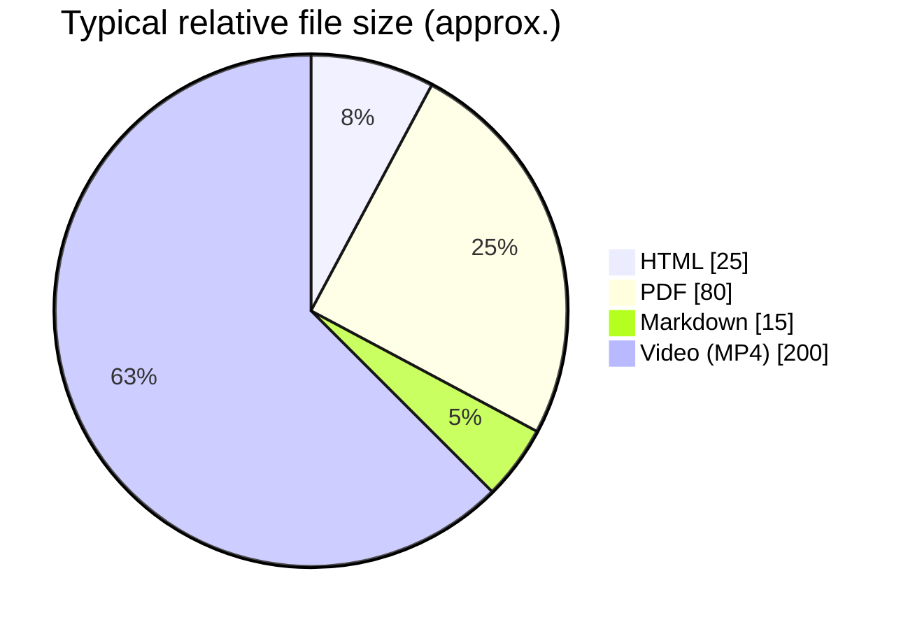

## Export Options

After recording, choose how to share your guide:

### Format comparison at a glance



### HTML
**Best for:** Interactive viewing, quick sharing, web

```
✅ Open in any browser
✅ Beautiful formatting
✅ Step-by-step viewing
✅ Lightweight file
❌ Can't edit easily
```

**File:** `ProjectGrandma_YYYYMMDD_HHMMSS.html`
**Size:** 2-50MB (depends on steps)

**Share:** Email the file, post on websites, embed in docs

### PDF
**Best for:** Printing, formal documents, archiving

```
✅ Professional appearance
✅ Print-friendly
✅ Page-by-page layout
✅ Cannot be modified (secure)
❌ Larger file size
❌ Not interactive
```

**File:** `ProjectGrandma_YYYYMMDD_HHMMSS.pdf`
**Size:** 5-100MB

**Share:** Email, print, attach to documents

### Markdown
**Best for:** Editing, Integration, Technical docs

```
✅ Editable text format
✅ Works with Git
✅ Convert to other formats
✅ Integrates with static site generators
❌ Images in separate folder
❌ Requires folder structure
```

**Files:**
- `ProjectGrandma_YYYYMMDD_HHMMSS.md` (text)
- `ProjectGrandma_YYYYMMDD_HHMMSS/` (images folder)

**Share:** Upload to GitHub, include in documentation

### Video (MP4)
**Best for:** Screencasts, detailed walkthroughs, YouTube

```
✅ Shows actual motion/timing
✅ Complete recording
✅ Play on any device
✅ Upload to YouTube/social media
❌ Larger file size
❌ Can't be easily edited
❌ Requires video player
```

**File:** `ProjectGrandma_YYYYMMDD_HHMMSS.mp4`
**Size:** 50-500MB (depends on FPS & length)

**Customize:**
- FPS: 1-10 (higher = smoother, bigger file)
- Resolution: Your screen resolution
- Duration: Matches recording length

**Share:** Email as cloud link, upload to video hosting

## Choosing the Right Format

| Need | Best Format | Why |
|------|-------------|-----|
| Share with colleagues | HTML | Quick, interactive, no software needed |
| Print instructions | PDF | Professional, printable, reliable |
| Create documentation | Markdown | Editable, version-controllable, integrates |
| YouTube/social | Video | Engaging, shows motion, viral-ready |
| Email users | HTML | Fast to load, beautiful in browser |
| Company handbook | PDF | Archivable, secured, consistent |
| GitHub wiki | Markdown | Editable, collaborative, tracked |
| Conference presentation | Video | Professional, engaging, portable |

## File Locations

All exports save to your Windows temp folder:
```
C:\Users\[YourUsername]\AppData\Local\Temp\
```

### Open Button
Click "Open" after recording to view instantly.

### Finding Files Manually
1. Open File Explorer
2. Press `Ctrl + L`
3. Paste: `%TEMP%`
4. Find `ProjectGrandma_*` files

## Tips for Each Format

### HTML Tips
- Works on mobile browsers
- Share via email - click to view
- Publish on any website
- Lightweight for web sharing

### PDF Tips
- Print to physical copy
- Professional distribution
- Digital signature compatible
- Large file size (compress if needed)

### Markdown Tips
- Edit step descriptions
- Add more detail after recording
- Commit to Git repository
- Include in GitHub README

### Video Tips
- Keep FPS low (3-5) for smaller files
- Trim before uploading to YouTube
- Add subtitles using video editor
- Compress before email

## Advanced: Combining Formats

Create a complete guide:
```
1. HTML → Quick view, interactive
2. PDF → Print version
3. Markdown → Edit & customize
4. Video → YouTube tutorial
```

Send HTML for quick viewing, PDF for printing, Markdown for updating!

Next: [Advanced Tips](/guide/tips/) for creating professional guides
