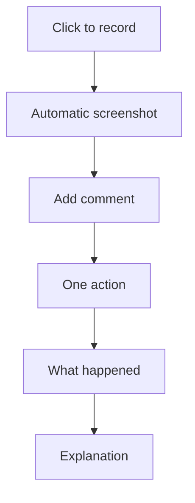

Welcome to **Project Grandma**! 👵

Project Grandma is a simple, elegant step recorder that captures everything you do and turns it into easy-to-follow guides. Perfect for explaining tasks to anyone, anywhere.

## Why Project Grandma?

### Beautiful Simplicity
It's designed like you're explaining something to your grandma - clear, simple, and straightforward.

### Multiple Export Formats
- **HTML**: Interactive step-by-step guide
- **PDF**: Printable document
- **Markdown**: Text with embedded images
- **Video**: MP4 recording of your actions

### Works Everywhere
- **Windows**: Windows 10 and later
- **macOS**: macOS 10.12 and later

## What It Does

1. **Records Steps**: Every click creates a new step
2. **Captures Screenshots**: Automatic visual documentation
3. **Detects Elements**: Shows what you clicked on Windows
4. **Adds Comments**: Explain confusing steps
5. **Exports Guides**: Share in multiple formats

## How It Works

## Getting Started

- [Install Project Grandma](/installation/)
- [Quick Start Guide](/quick-start/)
- [View Full Documentation](/guide/recording/)

## Inspired By

Project Grandma takes inspiration from Microsoft's Problem Steps Recorder but makes it friendlier, simpler, and cross-platform.

Visit the [Quick Start](/quick-start/) page to begin recording your first guide!
