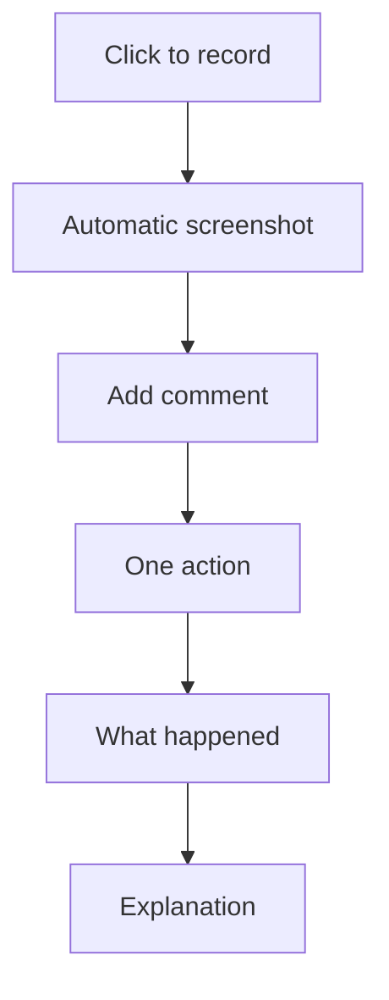

Welcome to **Project Grandma**! 👵

Project Grandma is a simple, elegant step recorder that captures everything you do and turns it into easy-to-follow guides. Perfect for explaining tasks to anyone, anywhere.

## Why Project Grandma?

### Beautiful Simplicity
It's designed like you're explaining something to your grandma - clear, simple, and straightforward.

### Multiple Export Formats
- **HTML**: Interactive step-by-step guide
- **PDF**: Printable document
- **Markdown**: Text with embedded images
- **Video**: MP4 recording of your actions

### Works Everywhere
- **Windows**: Windows 10 and later
- **macOS**: macOS 10.12 and later

## What It Does

1. **Records Steps**: Every click creates a new step
2. **Captures Screenshots**: Automatic visual documentation
3. **Click Circle**: Visual feedback shows exactly where you clicked (in the UI and on all exports)
4. **Detects Elements**: Shows what you clicked on Windows
5. **Adds Comments**: Explain confusing steps
6. **Exports Guides**: Share in multiple formats

## How It Works

## New & Notable

- **Click Circle** — A green circle appears at each click location during recording and on every exported screenshot (HTML, PDF, video). Customize color, size, and animation in [Click Circle docs](/features/click-circle/).
- **Export format comparison** — See [Export Comparison (Chart)](/guide/export-chart/) for a visual comparison of typical file sizes (HTML, PDF, Markdown, Video) to choose the right format.
- **E2E testing (Playwright)** — Docs and full recording flow are tested with [Playwright](/dev/playwright-e2e/); run `npm run test` from grandama, or `npm run test:full` for the full Grandma + recording + exports flow.
- **Full changelog** — See the project [CHANGELOG](https://github.com/ktsoaela/project_grandma/blob/main/CHANGELOG.md) for version history and planned features.

## Getting Started

- [Install Project Grandma](/installation/)
- [Quick Start Guide](/quick-start/)
- [View Full Documentation](/guide/recording/)
- [Click Circle customization](/features/click-circle/) — Change how click feedback looks
- [Export format comparison](/guide/export-chart/) — Compare HTML, PDF, Markdown, and Video sizes

## Inspired By

Project Grandma takes inspiration from Microsoft's Problem Steps Recorder but makes it friendlier, simpler, and cross-platform.

Visit the [Quick Start](/quick-start/) page to begin recording your first guide!
